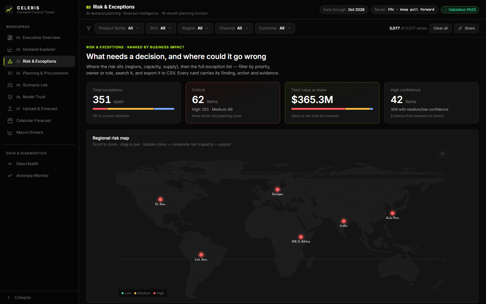
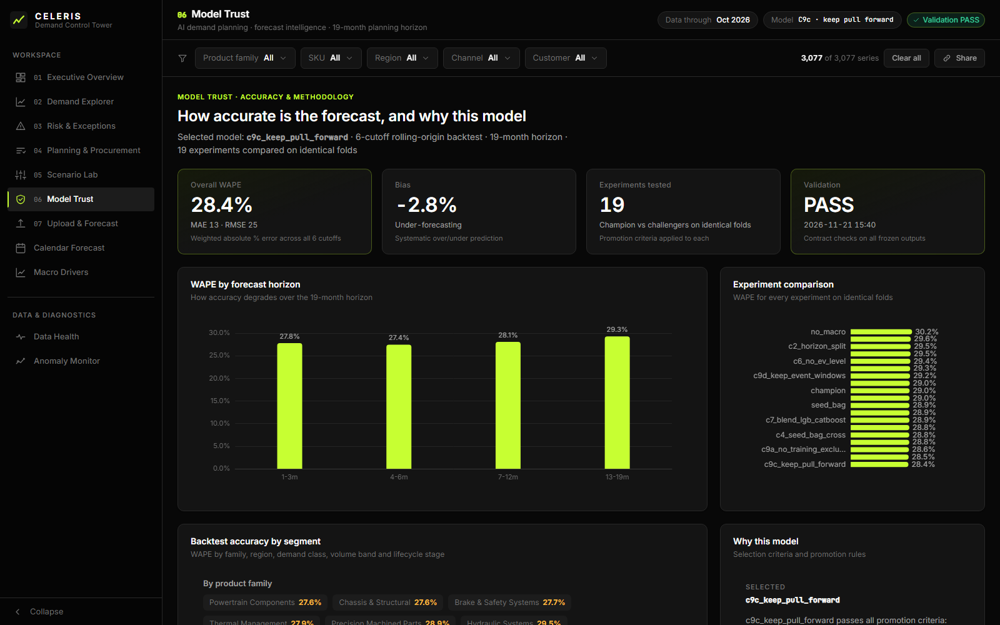
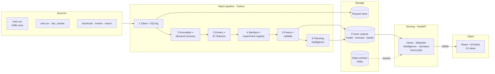
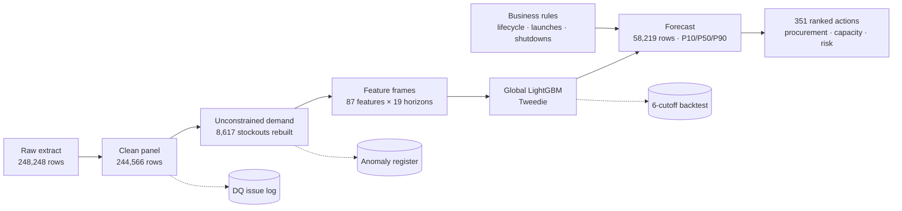
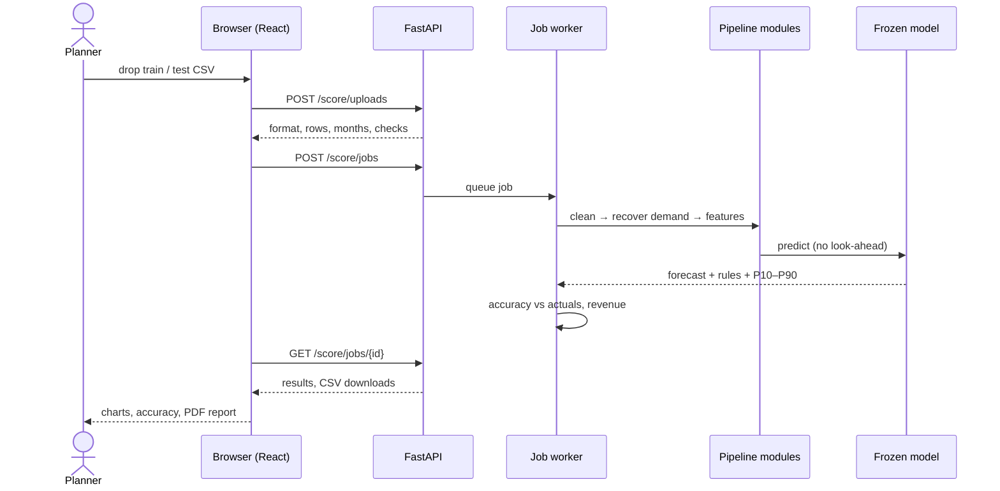
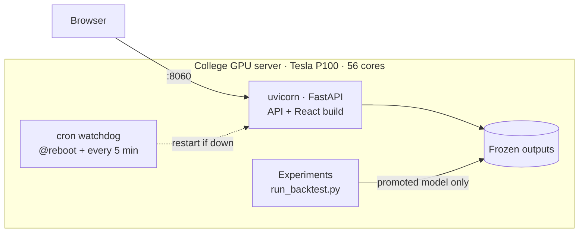

# Celeris Demand Intelligence Control Tower

**AI demand forecasting and planning control tower for Celeris Automobili** — MKS AI/ML Hackathon, Phase 2.
Messy ERP data cleaned and explained, true demand recovered, a validated 19-month forecast
(Nov 2026 → May 2028) for 3,068 SKU × region series, and a 12-view control tower that turns it into decisions.

**Deepak Meena · IIIT Delhi**

| | |
|---|---|
| 📊 **Presentation (12 slides, PDF)** | [docs/deck/celeris_presentation.pdf](docs/deck/celeris_presentation.pdf) |
| 🌐 **Live demo** | **http://192.168.2.254:8060** — college GPU server (college network / VPN) · [API docs](http://192.168.2.254:8060/docs) |
| 📄 **Submission** | [outputs/final/submission.csv](outputs/final/submission.csv) — 58,219 rows, all validation checks PASS |
| 📚 **Full technical write-up** | [docs/TECHNICAL.md](docs/TECHNICAL.md) |

---

## Results

Accuracy = 1 − WAPE on a **6-cutoff rolling-origin backtest** over the full 19-month horizon (months the model never saw).

| Level | Accuracy | Seasonal-naive baseline |
|---|---|---|
| Company × month | **94.9%** | — |
| Product family × month | **92.7%** | — |
| SKU × region × month | **71.6%** | 62.2% |

| Demand class | Series | Model | Baseline | Gain |
|---|---|---|---|---|
| Smooth | 2,207 | **72.1%** | 62.9% | +9.2 pts |
| Intermittent | 759 | **70.8%** | 60.6% | +10.2 pts |
| Erratic | 68 | **65.5%** | 56.6% | +8.9 pts |
| Lumpy | 13 | **66.1%** | 55.9% | +10.3 pts |

**Forecast:** 2.82M units over 19 months (P10–P90: 2.66M – 3.15M) · next 12 months **$1.61B** revenue (+11.0%) ·
**351** ranked actions (62 critical) · 42,223 data fixes logged · 21,951 anomalies explained.

---

## Screens

| Executive Overview | Risk & Exceptions |
|---|---|
|  |  |
| **Model Trust** | **Upload & Forecast** |
|  |  |

12 views: Landing · Executive Overview · Demand Explorer · Risk & Exceptions · Planning & Procurement · Scenario Lab ·
Model Trust · Upload & Forecast · Calendar Forecast · Macro Drivers · Data Health · Anomaly Monitor.

---

## Architecture



### Data flow



### Upload & Forecast (score any file in the competition format)



Uploading the official `train.csv` + `test.csv` reproduces the frozen submission **exactly** (tested).

---

## Live deployment



**Why it matters:** judges can use every page, filter, scenario and upload without installing anything · one
process serves API + dashboard, so nothing drifts out of sync · self-healing after a reboot or crash · the live site
serves the same frozen, fingerprinted numbers as this repo.

---

## Technology

| Layer | Stack |
|---|---|
| Data & ML | Python, pandas, NumPy, Parquet, **LightGBM** (CatBoost as challenger), scikit-learn, statsmodels |
| Backend | **FastAPI**, Uvicorn, background scoring jobs |
| Frontend | **React 18 + TypeScript**, Vite, Apache ECharts, React Router |
| Quality | typed data contract (YAML), **214 tests** (173 pytest + 41 vitest), SHA-256 manifest |

---

## Quick start

```powershell
pip install -r requirements.txt
python run_pipeline.py                     # rebuild every output from data/raw
uvicorn api.app:app --port 8000            # API (also serves the dashboard build)
npm --prefix dashboard install
npm --prefix dashboard run dev             # dashboard at http://localhost:5173
```

Tests: `python -m pytest tests -q` and `npm --prefix dashboard test`. Server deployment: [`deploy.sh`](deploy.sh) or
[DEPLOYMENT.md](DEPLOYMENT.md).

## Repository

```text
api/            FastAPI: views, datasets, intelligence, scenario engine, Upload & Forecast scoring
src/celeris/    pipeline: cleaning, anomalies, features, backtest, final freeze, intelligence, scoring
dashboard/      React + TypeScript control tower
contracts/      data contract (every dataset the dashboard may read)
config/         experiment registry definitions and promotion rule
outputs/final/  frozen forecast, submission, manifest, validation report
docs/           technical write-up, architecture notes, API contracts, presentation deck
tests/          backend tests (pipeline, API, contract, scoring)
```

## More documentation

- [docs/TECHNICAL.md](docs/TECHNICAL.md) — every stage, decision and result in detail
- [docs/dashboard_architecture.md](docs/dashboard_architecture.md) — dashboard design, views and data sources
- [docs/api_contracts.md](docs/api_contracts.md) — API endpoints with example responses
- [DEPLOYMENT.md](DEPLOYMENT.md) — deploying on a server
