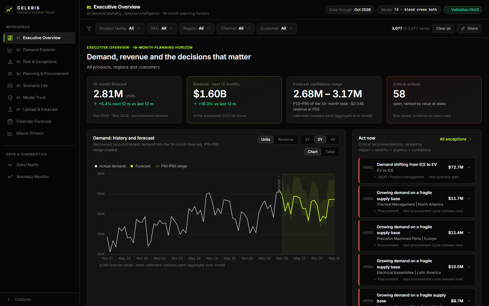
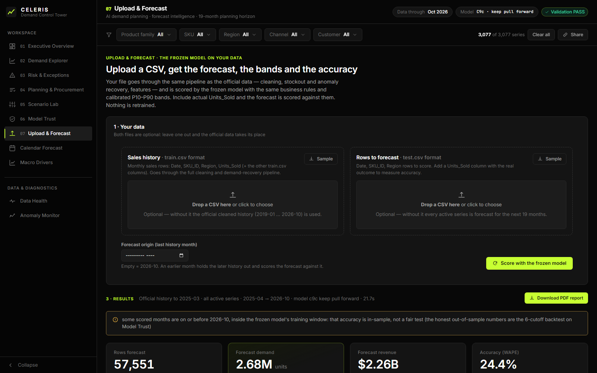
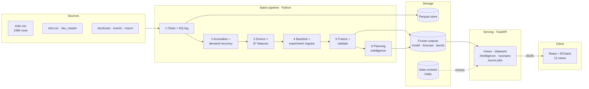
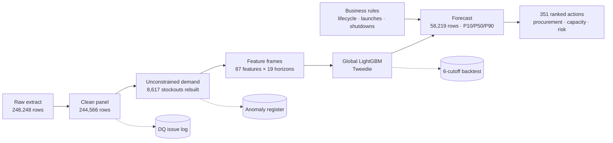
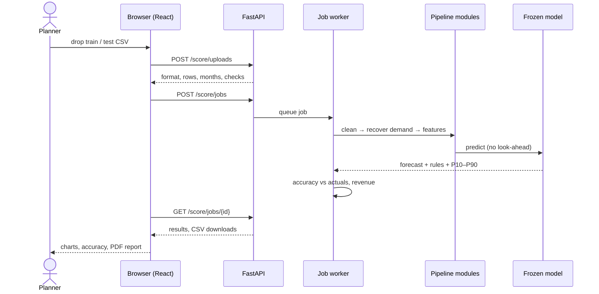
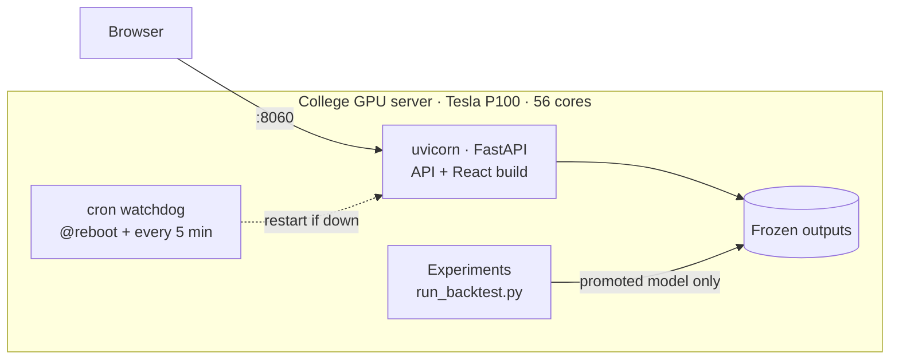

# Celeris Demand Intelligence Control Tower

**AI demand forecasting and planning control tower for Celeris Automobili** — MKS AI/ML Hackathon, Phase 2.
Messy ERP data cleaned and explained, true demand recovered, a validated 19-month forecast
(Nov 2026 → May 2028) for 3,068 SKU × region series, and a 12-view control tower that turns it into decisions.

**Deepak Meena · IIIT Delhi**

| | |
|---|---|
| **Presentation (12 slides, PDF)** | [docs/deck/celeris_presentation.pdf](docs/deck/celeris_presentation.pdf) |
| **Live demo** | **http://192.168.2.254:8060** — college GPU server (college network / VPN) · [API docs](http://192.168.2.254:8060/docs) |
| **Submission** | [outputs/final/submission.csv](outputs/final/submission.csv) — 58,219 rows, all validation checks PASS |
| **Full technical write-up** | [docs/TECHNICAL.md](docs/TECHNICAL.md) |

---

## Results

Accuracy = 1 − WAPE on a **6-cutoff rolling-origin backtest** over the full 19-month horizon (months the model never saw).

| Level | Accuracy | Seasonal-naive baseline |
|---|---|---|
| Company × month | **94.9%** | — |
| Product family × month | **92.7%** | — |
| SKU × region × month | **71.6%** | 62.2% |

| Demand class | Series | Model | Baseline | Gain |
|---|---|---|---|---|
| Smooth | 2,207 | **72.1%** | 62.9% | +9.2 pts |
| Intermittent | 759 | **70.8%** | 60.6% | +10.2 pts |
| Erratic | 68 | **65.5%** | 56.6% | +8.9 pts |
| Lumpy | 13 | **66.1%** | 55.9% | +10.3 pts |

**Forecast:** 2.82M units over 19 months (P10–P90: 2.66M – 3.15M) · next 12 months **$1.61B** revenue (+11.0%) ·
**351** ranked actions (62 critical) · 42,223 data fixes logged · 21,951 anomalies explained.

---

## Screens

| Executive Overview | Risk & Exceptions |
|---|---|
|  |  |
| **Model Trust** | **Upload & Forecast** |
|  |  |

### The 12 views

| View | What it answers |
|---|---|
| **Landing** | the headline story: live demand chart, forecast, revenue, accuracy, pipeline |
| **Executive Overview** | how much demand and revenue, is it growing, what could go wrong, what to do now |
| **Demand Explorer** | drill family → SKU → region → customer; seasonality, order patterns, lifecycle |
| **Risk & Exceptions** | world risk map, capacity heatmap, supply risk, all 351 actions with filters, search and CSV |
| **Planning & Procurement** | what to order next cycle, safety buffers, ABC-XYZ service levels, capacity |
| **Scenario Lab** | what if PMI / auto production / EV adoption changes — demand and revenue respond instantly |
| **Model Trust** | accuracy by horizon and segment, 19 experiments, band calibration, why this model |
| **Upload & Forecast** | upload your own CSV → same pipeline + frozen model → forecast, accuracy, CSV and PDF |
| **Calendar Forecast** | any date range inside the horizon: demand, revenue, growth, range, drivers |
| **Macro Drivers** | which indicator leads which family, by how many months, and is the lag stable |
| **Data Health** | 42,223 fixes by type and file, cleaning rules, before → after per raw file |
| **Anomaly Monitor** | 21,951 flagged months on the demand line, with type, reason and action |

Global filters (family, SKU, region, channel, customer) apply to every view and travel in the URL, so any view can be shared.

---

## Architecture



### Data flow



### Upload & Forecast (score any file in the competition format)



Uploading the official `train.csv` + `test.csv` reproduces the frozen submission **exactly** (tested).

---

## How it works — stage by stage

### 1 · Data cleaning — every fix logged
The raw ERP extract had **248,248** sales rows with duplicates, reloaded records, date and label variants, unit
errors and gaps. Cleaning produced **244,566** rows (one per date × SKU × region) and logged **42,223** fixes,
each with the original value, the corrected value and the rule.

| Fix | Rows | Rule (short) |
|---|---|---|
| Label variants (region, channel, customer, SKU) | 15,733 | map every spelling to the canonical label |
| Date formats and typos | 10,097 | parse all formats; repair year typos from Year/Month |
| Missing values recovered | 6,316 | units from revenue ÷ price; region / family from the SKU master |
| Duplicates and reloaded records | 3,682 | keep the latest load of each record and key |
| Price fixes | 1,792 | reconcile with the SKU reference price (2% tolerance) |
| Unit errors (×10 blocks, sign, packs) | 1,394 | rebuild from revenue and the stockout file |

Hard validation checks (one row per key, no negative units, revenue reconciles, all SKUs known) all **PASS**.

### 2 · Anomalies and true demand — learn demand, not shipments
When a product is out of stock, shipments fall but customers still want it. Training on shipments would forecast
too low, so the pipeline rebuilds **unconstrained demand** first. **21,951** months are flagged on 2,932 series:

| Category | Months | Action |
|---|---|---|
| Stockout | 8,617 | demand = shipments + measured shortfall (stockout file, diff-in-diff vs peers) |
| Real event (strike, shutdown, price pull-forward) | 7,033 | kept as history; excluded from training only if its impact was measured as material |
| Data error | 4,478 | corrected in stage 1 |
| Missing month | 1,352 | flagged; never treated as zero sales |
| One-off spike | 246 | kept in history, excluded from training |
| Unexplained drop | 225 | flagged for review |

### 3 · Drivers and features — 87 inputs, no look-ahead
- **Macro lead / lag:** auto production and new-vehicle orders lead demand by 3–4 months, PMI by 1–2 months; each
  link is checked for stability over time. EV share grew from 0% to 9.8% (2019 → 2026) and is modelled.
- **Feature groups:** demand history (lags 1–12, rolling statistics, same month last year), seasonality (family ×
  region index), lifecycle (age, months to EOL, launch ramp), macro leads, calendar and events (holidays,
  shutdowns, strikes), attributes (family, region, channel, customer).
- Every feature uses only data up to the forecast origin; only the calendar, lifecycle dates, scheduled events and
  the macro file are known in advance.

### 4 · Model and validation — tested like production
- **One global LightGBM** over all 3,068 series (Tweedie loss on demand ÷ series scale), direct multi-horizon:
  each row asks "standing at this month, what will demand be *h* months later?" for h = 1…19.
- **Rolling-origin backtest:** 6 cutoffs (2022-10 → 2025-03), each forecasting the next 19 months, never scored on
  training months.
- **19 experiments** under identical folds; a challenger is promoted only if it lowers WAPE by ≥ 0.2 points, wins ≥ 4
  of 6 cutoffs and is not worse on any cutoff, horizon or segment. Selected: **C9c** (keeps price pull-forward
  months in training) — WAPE 28.37% vs 28.97% for the first champion.
- A later tuning sweep on the GPU (tree size, learning rate, loss, regularisation, seeds) moved WAPE by < 0.1 point:
  the model is at its ceiling for the available information.

### 5 · Uncertainty, rules and freeze
- **P10 / P50 / P90 bands:** stratified split-conformal (size × horizon × age × volatility) fitted on the model's own
  backtest; held-out P10–P90 coverage ≈ 80–86% at every level. Aggregates (family, region, total) are exact sums of
  SKU forecasts with level-specific bands.
- **Business rules the model cannot learn:** zero outside launch → EOL, new launches from the predecessor's level ×
  a ramp-up curve, predecessor run-down while the successor ramps, scheduled customer shutdowns.
- **Freeze:** the final forecast, model and bands are written to `outputs/final/` with a SHA-256 manifest; 11
  validation checks (row count and order match `test.csv`, integers, no negatives, bands ordered, hierarchy sums…)
  all **PASS**.

### 6 · Planning intelligence — from forecast to decisions
- **351 ranked actions** (62 critical, 201 high) scored by impact × severity × urgency × confidence, each with a
  finding, action, owner, decision window and evidence.
- **Procurement:** next-cycle cover **$560.9M** (639K units, 3-month lead time), safety buffer 181K units,
  ABC-XYZ service levels (revenue-weighted 93.1%).
- **Capacity and supply risk:** 3-month P90 load vs demonstrated throughput per family × region (8 above),
  shortage history and lost demand per supply base.
- **Scenarios:** macro shocks re-forecast through the frozen model (Scenario Lab).

---

## Live deployment



**Why it matters:** judges can use every page, filter, scenario and upload without installing anything · one
process serves API + dashboard, so nothing drifts out of sync · self-healing after a reboot or crash · the live site
serves the same frozen, fingerprinted numbers as this repo.

---

## Technology

| Layer | Stack |
|---|---|
| Data & ML | Python, pandas, NumPy, Parquet, **LightGBM** (CatBoost as challenger), scikit-learn, statsmodels |
| Backend | **FastAPI**, Uvicorn, background scoring jobs |
| Frontend | **React 18 + TypeScript**, Vite, Apache ECharts, React Router |
| Quality | typed data contract (YAML), **214 tests** (173 pytest + 41 vitest), SHA-256 manifest |

---

## Quick start

```powershell
pip install -r requirements.txt
python run_pipeline.py                     # rebuild every output from data/raw
uvicorn api.app:app --port 8000            # API (also serves the dashboard build)
npm --prefix dashboard install
npm --prefix dashboard run dev             # dashboard at http://localhost:5173
```

Tests: `python -m pytest tests -q` and `npm --prefix dashboard test`. Server deployment: [`deploy.sh`](deploy.sh) or
[DEPLOYMENT.md](DEPLOYMENT.md).

## Repository

```text
api/            FastAPI: views, datasets, intelligence, scenario engine, Upload & Forecast scoring
src/celeris/    pipeline: cleaning, anomalies, features, backtest, final freeze, intelligence, scoring
dashboard/      React + TypeScript control tower
contracts/      data contract (every dataset the dashboard may read)
config/         experiment registry definitions and promotion rule
outputs/final/  frozen forecast, submission, manifest, validation report
docs/           technical write-up, architecture notes, API contracts, presentation deck
tests/          backend tests (pipeline, API, contract, scoring)
```

## More documentation

- [docs/TECHNICAL.md](docs/TECHNICAL.md) — every stage, decision and result in detail
- [docs/dashboard_architecture.md](docs/dashboard_architecture.md) — dashboard design, views and data sources
- [docs/api_contracts.md](docs/api_contracts.md) — API endpoints with example responses
- [DEPLOYMENT.md](DEPLOYMENT.md) — deploying on a server
